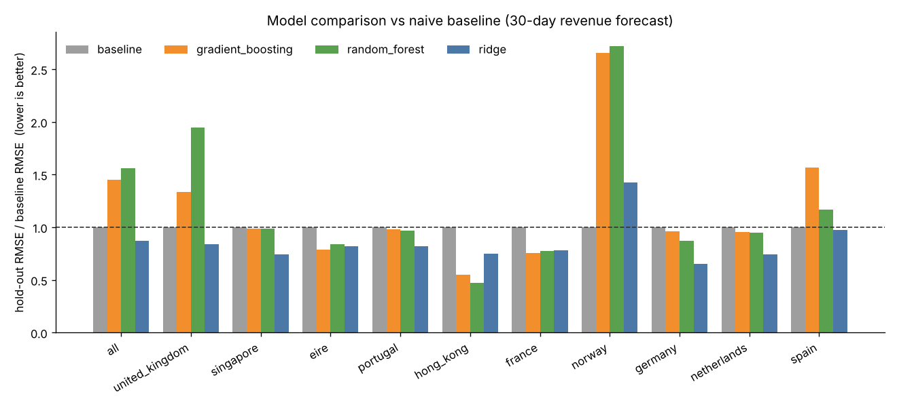
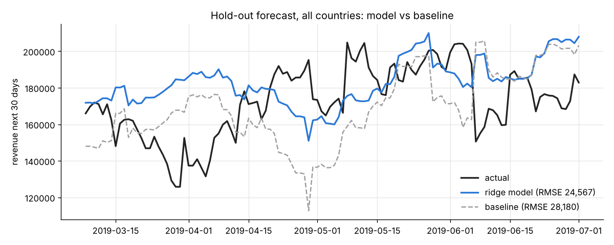
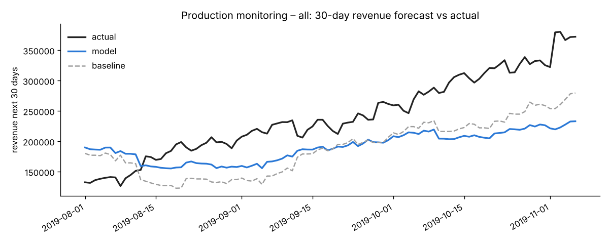

# AAVAIL Revenue Forecasting – AI Workflow: AI in Production (Capstone)

Forecast the **revenue of the next 30 days** for any given date, for each of the top-10 countries
and for all countries combined. The solution covers the full AI workflow: automated data
ingestion, EDA, comparison of several models against a baseline, a Flask API, logging,
performance monitoring, unit tests and a Docker image.

## Quick start

### Docker (recommended)

```bash
docker build -t aavail-capstone .
docker run -p 8080:8080 aavail-capstone
```

The image builds the cached time series and trains the production models during the build,
so the API answers as soon as the container starts.

### Local (Python 3.11+)

```bash
pip install -r requirements.txt
python cslib.py            # ingest data -> data/cs-train/ts-data/*.csv
python model.py            # compare models, train & save -> models/, reports/
python monitoring.py       # performance & drift on production data -> reports/
python app.py              # API on http://localhost:8080
```

### Run all unit tests with one command

```bash
python run-tests.py
# inside the container:
docker run --rm aavail-capstone python run-tests.py
```

25 tests: API (9), model (8), logging (5), monitoring (3) – all passing.

## API

| Method | Endpoint | Body / query | Description |
|---|---|---|---|
| GET | `/` | – | health check + available countries |
| POST | `/train` | `{"mode": "prod"}` or `{"mode": "test"}` | retrain (test mode = small isolated models) |
| GET/POST | `/predict` | `country, year, month, day, [mode]` | revenue forecast for the 30 days after the date |
| GET | `/monitor` | `[country]` | production performance + drift report |
| GET | `/logs/<file>` | e.g. `predict-test.log` | download a log file |

```bash
# all countries combined
curl -X POST http://localhost:8080/predict -H "Content-Type: application/json" \
     -d '{"country": "all", "year": "2018", "month": "01", "day": "05"}'
# a specific country (name or key)
curl "http://localhost:8080/predict?country=united_kingdom&year=2019&month=10&day=1"
```

```json
{"country": "all", "target_date": "2018-01-05", "y_pred": 154785.06,
 "model": "ridge", "model_version": 0.1}
```

Valid dates: 2017-11-28 – 2019-12-06 (training + production data). Countries: `all`,
`united_kingdom`, `eire`, `germany`, `france`, `norway`, `spain`, `hong_kong`, `portugal`,
`singapore`, `netherlands`.

## Project structure

```
├── app.py                  Flask API
├── cslib.py                data ingestion (fetch_data, fetch_ts) + feature engineering
├── model.py                model comparison, training, loading, prediction
├── estimators.py           naive baseline + "residual on baseline" wrapper
├── logger.py               train / predict logs (CSV)
├── monitoring.py           performance on production data + drift detection
├── run-tests.py            runs every unit test
├── unittests/              ApiTests, ModelTests, LoggerTests, MonitoringTests
├── notebooks/              eda-and-model-comparison.ipynb  (executed, with figures)
├── reports/                model-comparison.csv, monitoring-report.csv, figures/
├── data/cs-train, cs-production   raw invoice JSON files
├── models/                 trained models (sl-<country>-0_1.joblib)
├── Dockerfile, requirements.txt
```

## How the solution works

**Ingestion** – `cslib.fetch_data()` reads every monthly JSON file, harmonises the inconsistent
column names (`StreamID`/`stream_id`, `TimesViewed`/`times_viewed`, `total_price`/`price`),
validates the schema and builds an invoice date. `fetch_ts()` aggregates daily time series for the
top-10 countries + all, caches them as CSV and is what the API, training and tests call –
ingestion is a single function / script (`python cslib.py`) ready for automation.

**Features & target** – for each day: revenue over the previous 7/14/28/35/54 days, mean
invoices and views over the previous 30 days. Target: revenue over the following 30 days.

**Models compared** (per country, time-ordered hold-out = last 20 % of days with a 30-day gap,
hyper-parameters via `GridSearchCV` + `TimeSeriesSplit(gap=30)`):

* **baseline** – next 30 days = last 28 days × 30/28
* **Ridge**, **Random forest**, **Gradient boosting** – each learns the *residual* over the
  baseline (tree models cannot extrapolate the upward trend when trained on raw revenue)

The best model per country is refit on all the data and saved. A model beats the baseline for
10 of 11 series (all countries −13 %, UK −16 %); Norway keeps the baseline.




**Monitoring** – `monitoring.py` scores the deployed models on the unseen production data
(Aug–Dec 2019): RMSE / MAE / MAPE next to the baseline, an IsolationForest outlier rate on the
input features and a Wasserstein-distance drift test on the target with a bootstrap threshold.
Alerts are raised when production RMSE exceeds the hold-out RMSE by > 25 % or when drift is
detected. On this data the alerts fire – the 2019 holiday peak is larger than anything in the
training data – which is the signal to retrain with the new months (`POST /train {"mode":"prod"}`).



**Logging** – every training run and prediction appends a line (id, timestamp, country, shape /
target date, prediction or evaluation, runtime, model version) to `logs/train-YYYY-M.log` and
`logs/predict-YYYY-M.log`.

**Isolation of tests** – tests never touch production artefacts: models trained in test mode are
saved with the `test-` prefix, test-mode logs go to `logs/*-test.log`, and the logger tests write
into a temporary directory.

## Grading checklist

| Criterion | Where |
|---|---|
| Unit tests for the API | `unittests/ApiTests.py` |
| Unit tests for the model | `unittests/ModelTests.py` |
| Unit tests for the logging | `unittests/LoggerTests.py` |
| All tests with a single script, all pass | `python run-tests.py` (25/25 OK) |
| Mechanism to monitor performance | `monitoring.py`, `GET /monitor`, `reports/monitoring-report.csv` |
| Read/write tests isolated from production models & logs | `test-` model prefix, `*-test.log`, temp dir in `LoggerTests` |
| API works for one country and all countries | `/predict` with `country=all` or e.g. `country=united_kingdom` |
| Data ingestion as a function/script | `cslib.fetch_data()`, `cslib.fetch_ts()`, `python cslib.py` |
| Multiple models compared | `model.py`, `reports/model-comparison.csv` |
| EDA with visualisations | `notebooks/eda-and-model-comparison.ipynb`, `reports/figures/eda_*.png` |
| Containerised in a working Docker image | `Dockerfile` |
| Visualisation comparing the model to the baseline | `reports/figures/model_comparison.png`, `holdout_all_model_vs_baseline.png` |

Data source: [aavail/ai-workflow-capstone](https://github.com/aavail/ai-workflow-capstone).
